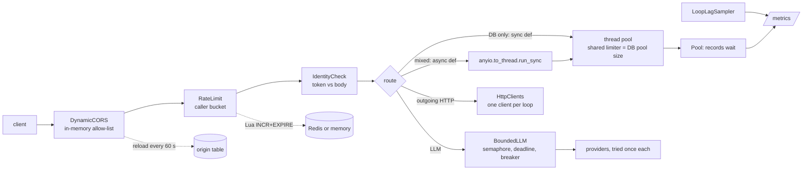

# fastapi-prod-hardening

Hardening patterns for a multi-tenant FastAPI service that calls LLMs, each one a small,
tested module you can lift on its own.

> An open-source reference implementation of hardening patterns for a multi-tenant FastAPI service that calls LLMs. All names and data are fictional.

[](https://github.com/Tayyab-Bilal/fastapi-prod-hardening/actions/workflows/ci.yml)

## The problem

A multi-tenant FastAPI service that calls LLMs needs the same handful of safeguards: working rate
limits, identity taken from the verified token, secrets kept out of logs, a bound on every LLM wait,
a strict CORS list, and no blocking database calls on the event loop.

This repo implements those safeguards in a fictional "Acme Workspace" API (projects, tasks, documents,
meetings), with fakes in place of the LLM providers, Redis and Postgres, so every claim here can be
checked by running the tests.

## What it does

| Capability | Code |
|---|---|
| Per-caller rate limits (user 300/min, job 3,000/min, other by last forwarded hop 100/min); atomic Redis Lua counter; fail open with a cooldown | `ratelimit.py` |
| Identity from the signed token, never the request body; measure mismatches first, then enforce | `identity.py` |
| Log redaction at the handler, re-installable; connection-string passwords scrubbed | `redaction.py` |
| Bounded LLM calls: concurrency cap, whole-call deadline, call-time breaker check, caller-facing stream cap | `bounded_llm.py` |
| Lifecycle-managed shared HTTP client, one per event loop, HTTP/2 when available, tenant headers per request | `http.py` |
| Large payloads travel by job id through a database table, deleted after delivery, 24 h sweep, 50 MB limit, argument names only in logs | `transcripts.py` |
| Event-loop hygiene: sync `def` for DB-only routes, `anyio.to_thread` for mixed routes, one shared thread budget sized to the DB pool | `app.py`, `threads.py`, `db.py` |
| Event-loop lag and DB pool-wait metrics at `/metrics`, with a `/health` canary load test | `metrics.py`, `scripts/loadtest.py` |
| Atomic counter with `UPDATE ... RETURNING` (no lost updates) | `counters.py` |
| CORS allow-list from the database, reloaded in the background, validated on add | `cors.py` |
| CI gates: JUnit report check, `--strict-skips`, migration-graph check, change-aware workflow templates | `scripts/`, `strict_skips.py`, `.github/workflows/` |

## Quickstart

```bash
uv venv .venv && uv pip install -e ".[dev]"
.venv/bin/pytest -q
.venv/bin/python examples/demo.py
```

Everything runs offline: a scripted `FakeProvider` for LLMs, `fakeredis[lua]` for Redis, SQLite for
the database, `httpx.MockTransport` for outgoing HTTP, injectable clocks. `httpx[http2]` is a
dependency (rather than plain `httpx`) because it installs `h2`, which enables HTTP/2 connection
reuse for the shared client. `uvicorn` is only in the `dev` extra, for the load-test harness.

Excerpt of the demo output:

```text
== 1. Rate limit per caller + identity from the token
anonymous IP bucket: 100 ok, request 101 -> 429
429 carries CORS: https://app.acme.example, Retry-After=59s
body says tenant 'someone-else', token says 'acme' -> saved for: acme

== 4. Bounded LLM calls
primary fails, backup answers: hello world
deadline hit; provider calls per fallback: [1, 1, 0, 0]

== 8. Transcript by job id, deleted after delivery
broker message: {'job_id': 'job-1'}
worker took: very long meeting transcript | rows left: 0

== 9. Atomic counter: 8 threads x 100 increments
recorded: 800 of 800
```

## Usage guide

The full guide with every module is [docs/usage.md](docs/usage.md). The shortest useful tour:

```python
import asyncio

from fastapi_prod_hardening.bounded_llm import BoundedLLM, FakeProvider


async def main() -> None:
    llm = BoundedLLM([FakeProvider("primary", fail_times=1), FakeProvider("backup")])
    print(await llm.complete("summarise my tasks"))


asyncio.run(main())
```

```python
from fastapi.testclient import TestClient

from fastapi_prod_hardening.app import create_app
from fastapi_prod_hardening.identity import Hs256Verifier, Identity

token = Hs256Verifier("dev-secret").issue(Identity("acme", "alice"))
with TestClient(create_app(secret="dev-secret")) as client:
    reply = client.post("/v1/tasks", json={"title": "Plan sprint", "tenant_id": "someone-else"},
                        headers={"authorization": f"Bearer {token}"})
    print(reply.json())  # saved for tenant "acme", whatever the body said
    assert reply.json()["tenant_id"] == "acme"
```

Signatures are in [docs/api.md](docs/api.md).

## How it works



A request passes the CORS layer first (so even a 429 carries CORS headers), then the limiter, which
picks a bucket from the service key and tokens, then the identity check, which compares the token's
tenant with any tenant named in the body. The route then runs on the right side of the event loop:
DB-only routes are plain `def` and run on the thread pool; mixed routes stay `async` and offload each
DB block through `anyio.to_thread.run_sync`. Both draw from one capacity limiter, sized to the DB
pool, so a request waits in a queue instead of waiting on the database connection pool.

An LLM call takes a slot in a per-loop semaphore, then tries each provider once, in order. Before
every attempt it asks the circuit breaker; an open circuit raises at once and sends nothing. The
240 s deadline is checked before each fallback.

## Design decisions

1. **Rate-limit per caller, not per IP.** Behind one gateway every request has the same source
   address. Rejected: removing the broken skip list and leaving an IP bucket, which would put the
   whole product in one 100/min bucket. The user token is trusted only together with a valid service
   key (constant-time compare); otherwise anyone could pick any bucket by sending a header.
2. **Skip lists are exact-match.** The limiter never ran because `"/"` sat in a prefix skip list and
   matched every path. Rejected: prefix matching.
3. **Fail open, with a cooldown.** A 250 ms Redis deadline, then a 30 s in-memory cooldown. Rejected:
   waiting on a hung Redis, which held every request for about 10 s.
4. **Identity from the token, measure first.** A measure mode logs body-versus-token mismatches
   before anything is enforced. Rejected: enforcing on day one, which could break clients nobody
   had measured.
5. **Redact at the handler.** A filter on a parent logger never sees records from child loggers.
   Rejected: a logger-level filter.
6. **Every LLM call is bounded.** The base is per-attempt timeouts and a circuit
   breaker. On top of that: the concurrency cap, the whole-call deadline, the stream caps and the
   call-time breaker check. Fallbacks never retry, so waits do not multiply.
7. **Per-loop state.** A semaphore or an HTTP client binds to the loop that first
   uses it, and a worker calling `asyncio.run()` repeatedly creates a new loop each time. Rejected:
   one global object.
8. **The stream cap applies to caller-facing streams only.** Every model streams internally, so a
   short cap on all streams would cut background work. Background streams get a 900 s backstop.
9. **Streaming uses the first healthy provider; there is no mid-stream fallback.** A provider that
   fails before its first token is skipped. After the first token the caller has seen output, and
   switching would splice two answers together. Rejected: buffering the whole stream to allow a
   switch, which defeats streaming.
10. **The HTTP client is a singleton and carries no tenant data.** Reuse avoids new connections
    and handshakes. Tenant and token headers are arguments to each call, so one tenant's credentials
    can never leak into another's request.
11. **Sync `def` for DB-only routes, `to_thread` for mixed ones, not `AsyncSession`.** `AsyncSession`
    means rewriting every call site and a second connection pool against a database with a hard
    connection limit. One shared limiter, sized to the DB pool, covers both paths. Offloads must use
    `anyio.to_thread` (not `asyncio.to_thread`), or they draw from a different budget.
12. **Measure first.** The loop-lag sampler and the pool-wait histogram came before the refactor,
    with a `/health` canary in the load test, so the improvement could be shown and not assumed.
13. **Large payloads go through the database, by job id.** A broker copies a message into its queue,
    retries, task UIs and log indexes. A database row has one copy, tenant scoping and a one-statement
    delete. Rejected: object storage in the request path.
14. **Atomic counters use one statement.** Read-add-write in application code loses updates under
    concurrency; `UPDATE ... RETURNING` does not.
15. **CORS from data, never per request.** An in-memory list reloaded every 60 s; if the database is
    down the last good list stays. Empty table means no origins allowed, so rolling it out changes
    nothing until rows are added.
16. **CI: change-aware, with gates that cannot pass by not running.** See
    [docs/change-aware-ci.md](docs/change-aware-ci.md). A report that is missing, empty or all
    skipped fails; DB suites fail on any skip; the migration graph is checked without importing app code.

## Testing

```bash
.venv/bin/pytest -q            # 100 tests, about 10 s, no network
.venv/bin/ruff check .
```

| Invariant | Test |
|---|---|
| A `"/"` skip entry would bypass the limiter | `test_root_prefix_skip_list_would_bypass_everything` |
| User bucket needs a valid service key | `test_user_bucket_needs_valid_service_key` |
| 429 carries CORS headers and `Retry-After` | `test_429_has_cors_and_retry_after` |
| Redis failure fails open with a cooldown | `test_redis_failure_fails_open_with_cooldown` |
| Identity comes from the token, not the body | `test_identity_from_token_not_body` |
| Redaction works for child loggers; reinstall after a handler swap; scrubbing is idempotent | `test_child_logger_record_redacted_at_handler`, `test_reinstall_after_framework_replaces_handlers`, `test_scrubbing_twice_equals_scrubbing_once` |
| Deadline stops fallbacks; open circuit sends nothing | `test_deadline_stops_new_fallbacks`, `test_open_circuit_fails_fast_with_zero_calls` |
| Streams use the first healthy provider, no mid-stream fallback | `test_stream_uses_first_healthy_provider`, `test_stream_does_not_fall_back_after_first_token` |
| One client per loop; tenant headers never stored on the client | `test_one_client_per_event_loop`, `test_tenant_headers_are_per_request_never_stored_on_the_client` |
| Transcript deleted after delivery; 24 h sweep; 50 MB limit; names-only task log | `tests/test_transcripts.py` |
| Sync routes and offloads share one thread budget | `test_sync_routes_and_offloads_share_one_thread_budget` |
| Loop lag sees a blocked loop; pool wait is recorded | `tests/test_metrics.py` |
| Atomic counter loses no updates under 8 threads | `test_atomic_counter_never_loses_updates_under_concurrency` |
| JUnit gate: missing, empty, all-skipped | `tests/test_ci_gates.py` |
| `--strict-skips` fails on a skip | `test_strict_skips_fails_the_run_when_a_test_is_skipped` |
| Migration graph: duplicates, missing parent, cycle, multiple heads, no import | `tests/test_ci_gates.py` |
| Every code block in these docs runs | `tests/test_docs.py` |

## Limits & known trade-offs

- `MemoryBackend` is per process: N workers allow N times the limit. Use `RedisBackend` when shared.
- Streams use the first healthy provider and never switch mid-stream.
- `HttpClients.aclose()` closes only the running loop's client; other loops' clients close with their loops.
- `/metrics` is unauthenticated and the metrics are in process (per worker); a real deployment would use Prometheus.
- `Hs256Verifier` is a stand-in, not a full JWT implementation.
- The CI files other than `ci.yml` are templates; they are validated for shape but not run here.
- `scripts/loadtest.py` is a harness, not a benchmark: numbers depend on your machine and are not CI-gated.
- SQLite serialises writers, so the atomic counter test proves correctness, not Postgres-scale throughput.
- Not here: connection budgets per service role, advisory-lock migrations, self-healing background
  sweeps, billing and review workflows.

## Project layout

```text
src/fastapi_prod_hardening/
  app.py           example API wiring everything together (sync, mixed and metrics routes)
  ratelimit.py     per-caller buckets, Redis Lua backend, fail-open limiter and middleware
  identity.py      token verification, identity dependency, measure/enforce check
  redaction.py     handler-level log scrubbing
  bounded_llm.py   concurrency cap, deadline, breaker, stream caps, FakeProvider
  http.py          shared per-loop httpx client with per-request headers
  transcripts.py   job-id payload store, sweep, names-only task log
  db.py            bounded connection pool that records wait time
  counters.py      atomic UPDATE ... RETURNING counter
  metrics.py       loop-lag sampler, histograms, /metrics text
  threads.py       one shared anyio thread limiter
  cors.py          database allow-list, background reload, admin validation
  strict_skips.py  pytest plugin: --strict-skips
scripts/           check_junit.py, check_migrations.py, loadtest.py
tests/             one file per module, fixtures/ for migration folders, test_docs.py
examples/demo.py   ten-section offline walkthrough
docs/              usage.md, api.md, change-aware-ci.md
.github/workflows/ ci.yml and the change-aware and DB-suite templates
```
